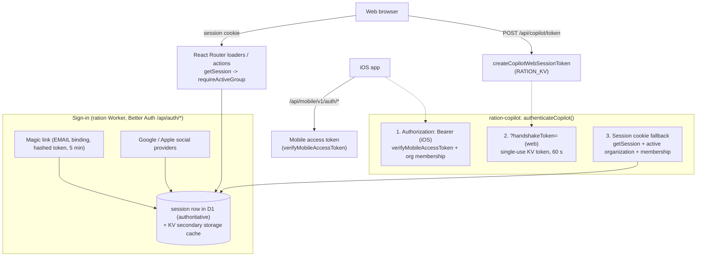
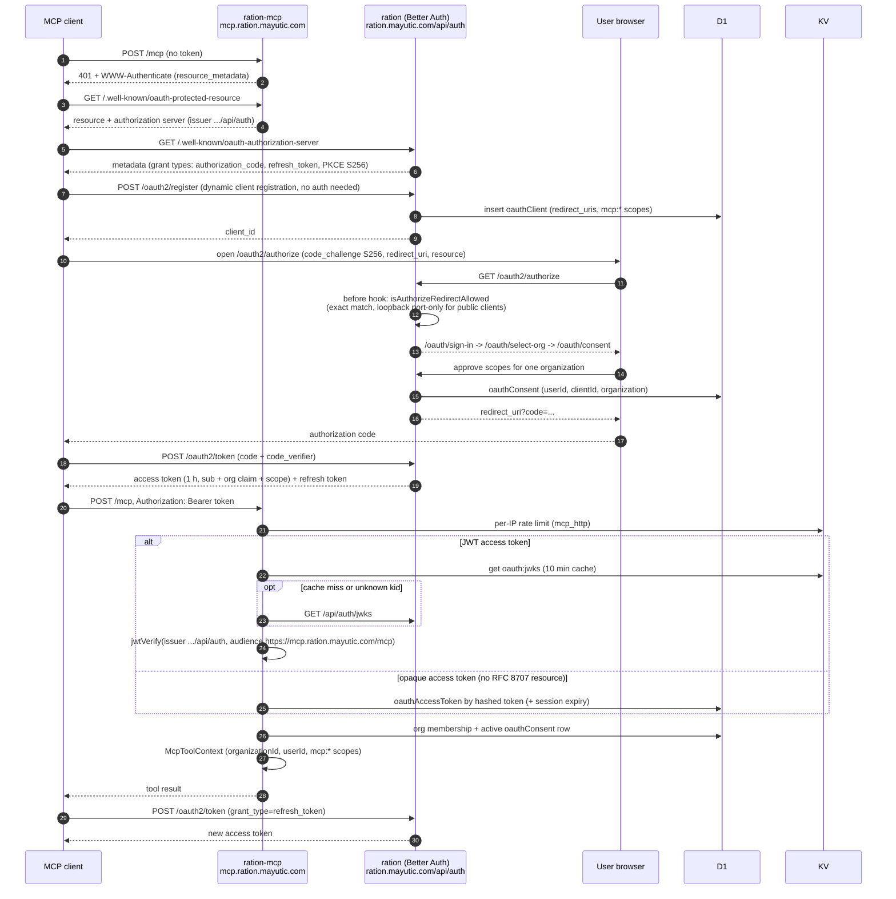
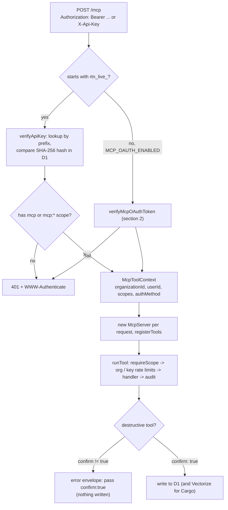

# Auth: sessions, OAuth and MCP

All identity lives in the `ration` Worker through **Better Auth** (`app/lib/auth.server.ts`), mounted at `/api/auth/*`. The same Better Auth instance is the **OAuth authorization server** for MCP clients (`@better-auth/oauth-provider` plus the `jwt`, `organization` and `magicLink` plugins). `ration-mcp` is the **resource server**: it never issues tokens, it only validates them.

## 1. Sessions for web, iOS and Copilot

- Sessions are stored in D1 (`storeSessionInDatabase: true`). KV (`RATION_KV`) is a read-through `secondaryStorage` cache, and D1 stays the source of truth for revoke and purge.
- Routes resolve the tenant with `requireActiveGroup`, which returns the session's active **organization** (group). Every query is scoped to that organization ID, never to client input.
- Copilot tries the iOS bearer token first, then the web handshake token, then the session cookie. After that it checks AI consent and the `ration-copilot` flag (see [request-flow.md](./request-flow.md)).

## 2. MCP OAuth: authorization_code + PKCE + refresh_token

- **Grant types**: `OAUTH_GRANT_TYPES = ["authorization_code", "refresh_token"]`. `client_credentials` is not offered, so every MCP token comes from a user's consent.
- **PKCE**: Ration's code doesn't set this. `@better-auth/oauth-provider` 1.7.10 requires PKCE by default: `isPKCERequired` returns true for public clients and for `requirePKCE ?? true`, and the plugin accepts only `S256`.
- **Dynamic client registration**: `allowDynamicClientRegistration: true` and `allowUnauthenticatedClientRegistration: true`. Registered clients may only request the MCP resource and the scopes in `OAUTH_REGISTRATION_SCOPES`.
- **Loopback redirects (RFC 8252)**: redirect URIs must match exactly. The one exception is a public client (`token_endpoint_auth_method: none`) using `http://127.0.0.1`, `http://[::1]` or `http://localhost`, where only the port may differ. The URLs are compared as parsed URLs, never as prefixes or regexes. Native callback schemes (`cursor:`, `warp:`, `vscode:`, `windsurf:`) are listed in `NATIVE_MCP_CALLBACK_PROTOCOLS`.
- **Organization binding**: `/oauth/select-org` sets the active organization. `consentReferenceId` stores it on the consent, and `customAccessTokenClaims` puts it in the token under the `https://ration.mayutic.com/org` claim. `ration-mcp` rejects a token if that claim is missing, the user is no longer a member, there are no `mcp:*` scopes, or the consent row has been deleted. Deleting the consent revokes access immediately.
- **Scopes**: `mcp:read`, `mcp:inventory:write`, `mcp:galley:write`, `mcp:manifest:write`, `mcp:supply:write`, `mcp:preferences:write`, `mcp:nutrition:read`, `mcp:nutrition:write`. Only `mcp:read` is checked by default on the consent screen.

## 3. API keys and tool gates in ration-mcp

- **API keys** are organization-scoped, start with `rtn_live_`, and are stored only as a SHA-256 hash (`app/lib/api-key.server.ts`). A legacy blanket `mcp` scope is expanded into the granular scopes and written back.
- **Tool annotations**: `registerSharedMcpTool` sets `destructiveHint` and `readOnlyHint` for hosts. Destructive tools also take a `confirm` argument and refuse to run without `confirm: true`. For example, `remove_cargo_item` in `app/lib/mcp/tools/inventory.ts`. The full list of `confirm`-gated tools is in [docs/mcp/README.md](../mcp/README.md).

## Verified against

- `app/lib/auth.server.ts`: `betterAuth({ secondaryStorage, session.storeSessionInDatabase, hooks.before (isAuthorizeRedirectAllowed), plugins: [jwt(), oauthProvider({ loginPage, consentPage, resources, grantTypes, validateRedirectUri, allowDynamicClientRegistration, allowUnauthenticatedClientRegistration, postLogin, customAccessTokenClaims }), organization(), magicLink()], socialProviders })`.
- `app/lib/oauth.constants.ts`: `OAUTH_MCP_SCOPES`, `OAUTH_GRANT_TYPES`, `OAUTH_ACCESS_TOKEN_TTL_SEC = 3600`, `RATION_ORG_CLAIM`, `MCP_RESOURCE_AUDIENCE_PROD`, `resolveAuthorizationServerIssuer` (`/api/auth`), `isApiKeyCredential` (`rtn_live_`), `NATIVE_MCP_CALLBACK_PROTOCOLS`, `buildMcpWwwAuthenticate`.
- `app/lib/oauth-loopback-redirect.ts`: `LOOPBACK_HOSTS`, `matchesRegisteredRedirectUri`, `isAuthorizeRedirectAllowed`.
- `node_modules/@better-auth/oauth-provider` 1.7.10 (version pinned in `package.json`): `isPKCERequired`, `code_challenge_methods_supported: ["S256"]`, `/oauth2/token` and `/oauth2/register` endpoints.
- `workers/mcp.ts`: protected-resource metadata, `authenticateMcp`, 401 with `WWW-Authenticate`, `mcp_http` rate limit.
- `app/lib/mcp/auth.ts`: `authenticateMcp`, `authenticateApiKey`, `authenticateOAuthToken`, `MCP_AUTH_ERRORS`, `McpToolContext`.
- `app/lib/mcp/oauth-token.server.ts`: `verifyMcpOAuthToken`, `verifyJwtMcpAccessToken` (KV `oauth:jwks`, 600 s, refetch on unknown `kid`), `verifyOpaqueMcpAccessToken`, `finalizeVerifiedToken` (membership, scopes, `hasActiveConsent`).
- `app/lib/api-key.server.ts`: `KEY_PREFIX`, `hashApiKey`, `verifyApiKey`.
- `app/lib/mcp/tool-runtime.ts`: `runTool` (`requireScope`, `checkRateLimit`, `auditMcpWrite`), `registerSharedMcpTool` annotations.
- `app/lib/mcp/tools/inventory.ts`: `remove_cargo_item` with `confirm` and `destructiveHint: true`.
- `app/lib/copilot/auth.server.ts`, `app/lib/copilot/web-session-token.server.ts`, `app/routes/api/copilot.token.ts`.
- `app/routes.ts`: `api/auth/*`, `oauth/sign-in`, `oauth/consent`, `oauth/select-org`, `.well-known/oauth-authorization-server`, `.well-known/oauth-protected-resource`, `api/mobile/v1/auth/*`.

**Not covered**: how the iOS mobile access token is built and verified (`app/lib/mobile/token.server.ts`) beyond the fact that `verifyMobileAccessToken` checks it. The REST API v1 (`/api/v1/*`, API-key auth) is also out of scope.
