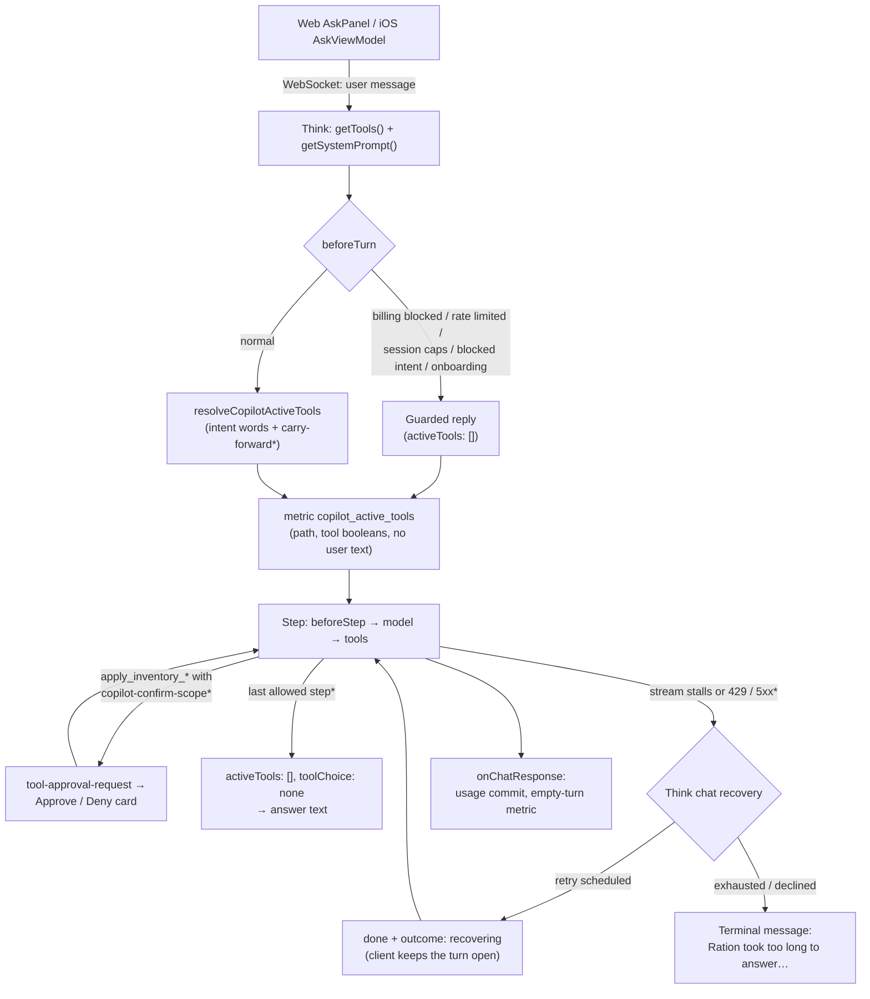

# Copilot turn

One Ask Ration turn in the `ration-copilot` Worker (`CopilotAgent`, Cloudflare Think). The client opens a WebSocket to the agent's Durable Object, sends the user message, and renders the streamed frames. Think builds the tool list and system prompt, then calls `beforeTurn`, which picks the tools for this turn and applies the guards. Each step runs `beforeStep`, the model, any tool calls (with a host Approve card when a tool needs approval), and `onStepFinish`. `onChatResponse` settles usage when the turn ends.

Two flags change this path. Both default **off**: `copilot-confirm-scope` (bulk remove / import consent) and `copilot-recovery-tuning` (stall and error recovery). With both off, the turn behaves as it did before 1.11.27. The only addition is metrics.

`*` only when the matching flag is on.

## Paths

- **Tool scoping.** `resolveCopilotActiveTools` keeps core read tools and opens write groups from the user's words. With `copilot-confirm-scope` on, a successful `preview_inventory_remove`, `preview_inventory_import` or `propose_manifest_plan` keeps its write group open for 15 minutes (the preview token TTL), so "yes" or "go ahead" can still reach the apply tool. A successful apply closes it. Carry-forward only re-opens tools that `getTools()` already offered. The list is kept in the agent's config (per conversation) so it survives hibernation.
- **Host approval.** The shared `apply_inventory_remove` / `apply_inventory_import` definitions have no `needsApproval`, so MCP clients are unchanged. Copilot adds approval through `toAiSdkTools(..., { approvalOverride })`, read at call time so the flag value from `beforeTurn` applies to the same turn.
- **Guards.** Billing blocked, rate limited, session message cap, session token cap, blocked intent and onboarding turns reply without tools. Each writes `copilot_active_tools` with its path name.
- **Stall recovery.** Think detects a stalled stream (preset `chatStreamStallTimeoutMs`) and schedules a retry, sending `done` with `outcome: "recovering"`. Web and iOS 1.6.40+ keep the turn open, show it as still working, and adopt the retry's request id so Stop cancels it. With `copilot-recovery-tuning` on, a turn that started in this isolate gets one retry within 60 seconds. 429 and 5xx errors route into the same retry. Recovery after a deploy or eviction runs in a fresh isolate and keeps Think's defaults (10 attempts, 5 minutes without progress). iOS below 1.6.40 drops frames after the recovering `done`, so it gets an immediate `copilot_stalled` error and the retry is declined.
- **Step cap.** With `copilot-recovery-tuning` on, the last allowed step runs with no tools and must answer.
- **Credits.** With `copilot-recovery-tuning` on, when the mid-turn balance check blocks billing, the client gets a `billing_stopped` error once.

## Metrics (Analytics Engine, `writeCopilotMetric`)

No metric carries user text. Blobs hold path names, presets and booleans; doubles hold counts and lengths.

| Event | When |
|-------|------|
| `copilot_active_tools` | Every turn, every `beforeTurn` path: path, preset, whether each apply / commit tool is active, carried domains; tool count and user-text length. |
| `confirm_without_apply` | A carried domain was live, the reply was short, and no tool ran. |
| `copilot_stall`, `copilot_retry_scheduled` | `onChatRecovery`: first and later attempts, live vs wake, tuned vs default. |
| `copilot_recovery_exhausted` | Recovery gave up (reason, kind, attempt). |
| `copilot_step_cap` | The final-step guard ran. |
| `copilot_billing_stop` | `billing_stopped` was sent. |
| `copilot_empty_turn` | A completed turn had no text, no tool part and no approval pause. |

## Verified against

- `workers/copilot.ts`: `chatRecovery`, `classifyChatError`, `onChatRecovery`, `getModel`, `getTools`, `beforeTurn` / `resolveBeforeTurn`, `beforeStep`, `afterToolCall`, `onStepFinish`, `onChatResponse`.
- `app/lib/copilot/active-tools.server.ts`: `resolveCopilotActiveTools`, `nextCarryForwardEntries`, `liveCarryForwardDomains`.
- `app/lib/copilot/chat-recovery.ts`: recovery config, error classification, final-step config, iOS version gate.
- `app/lib/copilot/tools.server.ts`: `toAiSdkTools` `approvalOverride`.
- `app/lib/copilot/turn-text.ts`: `lastUserText`.
- `app/lib/copilot/agent-frame.client.ts`, `app/components/support/AskPanel.tsx`: `turn_recovering`, `recovering`.
- `ios/Ration/Features/Ask/CopilotWebSocketDecoder.swift`, `CopilotTurnReducer.swift`, `AskViewModel+Stream.swift`.
- `node_modules/@cloudflare/think` 0.20.2 and `agents` 0.28.1: `done` + `outcome: "recovering"`, `cf_agent_chat_recovering`, `shouldKeepRecovering` from attempt 2.
