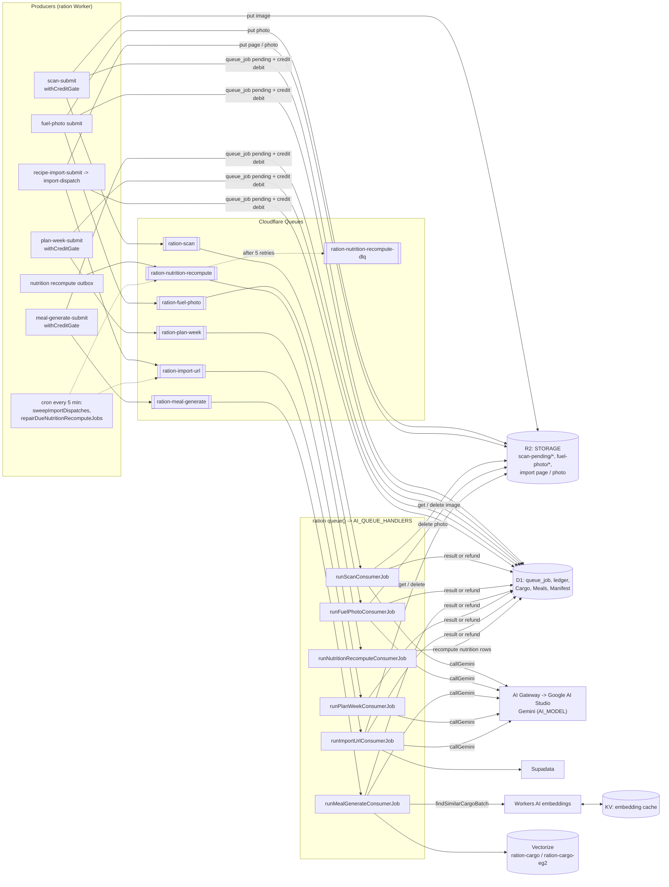
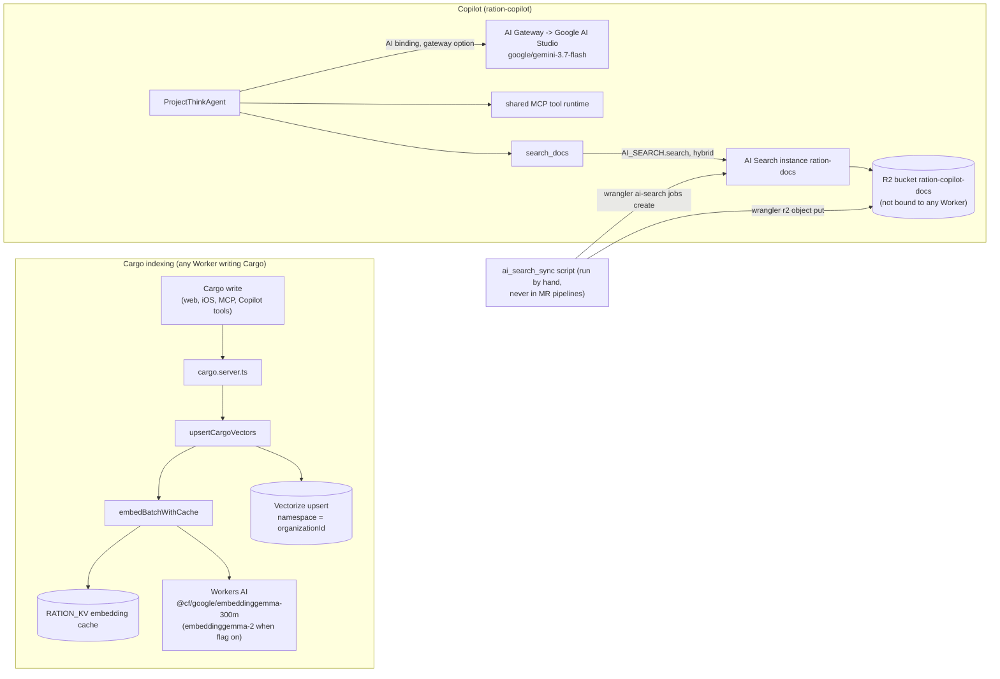

# Queue and AI pipeline

Long-running AI work runs asynchronously in the `ration` Worker. A route checks the request, debits credits, writes a `queue_job` row in D1 and sends a message to a Cloudflare Queue. The same Worker's `queue()` handler takes the message, calls Gemini through AI Gateway, and writes the result back to `queue_job`, which web and iOS poll. If a consumer fails, `failAiJobWithRefund` returns the credits. Embeddings and Vectorize indexing run on **Cargo writes**, not inside the queue consumers. `ration-mcp` and `ration-copilot` have no queue bindings.

## Notes

- **Queue settings** (`wrangler.jsonc`): scan and fuel-photo use batches of 5. Meal-generate, plan-week and import-url use batches of 3. All five retry 3 times. Nutrition recompute uses batches of 5, retries 5 times with a 15 s delay and a max concurrency of 2, and then goes to `ration-nutrition-recompute-dlq`. The consumer acks unknown queues and retries on any thrown error (`workers/app.ts`).
- **Gemini calls** go through `callGemini` / `callGeminiWithArtifact` (`app/lib/ai-gateway.server.ts`, `app/lib/queue-job.server.ts`). These build the AI Gateway URL from `AI_GATEWAY_ACCOUNT_ID` and `AI_GATEWAY_ID` (values not shown here) for provider `google-ai-studio` and model `AI_MODEL` (`gemini-3.5-flash-lite`). They also set the `cf-aig-*` timeout, retry, cache and metadata headers.
- **Nutrition recompute** does no AI. It recomputes nutrition rows in D1 from an outbox. The 5-minute cron re-wakes any jobs the queue missed.
- **Meal generation** checks generated Ingredients against Cargo with Vectorize: `findSimilarCargoBatch` embeds the names, then queries the organization's namespace.
- **Copilot AI Search**: `search_docs` calls `env.AI_SEARCH.search` with `instance_ids: ["ration-docs"]` and `retrieval_type: "hybrid"`. The app code does no chunking or ranking itself. The corpus is uploaded by hand from `docs/fin`, `content/blog`, `docs/dev`, `docs/legal` and `README.md` (plus `docs/mcp` once that sync change lands). **`docs/architecture/` is not in the sync list**, so these pages are not visible to Copilot unless someone adds it.
- **(unverified)** `app/lib/nutrition/ai-estimate.server.ts` and `app/lib/nutrition/propose-food-log.server.ts` also call `callGemini`. Not every call site was traced, so they are not drawn as a separate inline path.

## Verified against

- `wrangler.jsonc`: `queues.producers` (`SCAN_QUEUE`, `FUEL_PHOTO_QUEUE`, `MEAL_GENERATE_QUEUE`, `PLAN_WEEK_QUEUE`, `IMPORT_URL_QUEUE`, `NUTRITION_RECOMPUTE_QUEUE`), `queues.consumers` (batch, retry, DLQ settings), `triggers.crons`.
- `wrangler.mcp.jsonc`, `wrangler.copilot.jsonc`: no `queues` block.
- `workers/app.ts`: `queue()` dispatch through `AI_QUEUE_HANDLERS`, ack and retry, `scheduled()` running `repairDueNutritionRecomputeJobs` and `sweepImportDispatches` every 5 minutes.
- `app/lib/ai-queue-registry.server.ts`: queue-name to consumer map.
- `app/lib/scan-submit.server.ts`: `scan-pending/` R2 key, `withCreditGate`, `SCAN_QUEUE.send`.
- `app/lib/scan-consumer.server.ts`: `STORAGE.get` / `STORAGE.delete`, `callGeminiWithArtifact`, `failAiJobWithRefund`.
- `app/lib/meal-generate-submit.server.ts`, `app/lib/meal-generate-consumer.server.ts`: `MEAL_GENERATE_QUEUE.send`, `callGeminiWithArtifact`, `findSimilarCargoBatch`.
- `app/lib/plan-week-submit.server.ts`, `app/lib/plan-week-consumer.server.ts`: `PLAN_WEEK_QUEUE.send`, `callGeminiWithArtifact`.
- `app/lib/recipe-import-submit.server.ts`, `app/lib/import-dispatch.server.ts`, `app/lib/import-url-consumer.server.ts`: R2 page and photo keys, `IMPORT_URL_QUEUE.send`, `SUPADATA_API_KEY`, `callGeminiWithArtifact`.
- `app/lib/nutrition/fuel-photo.server.ts`: `STORAGE.put` / `STORAGE.delete`, `FUEL_PHOTO_QUEUE.send`, `callGemini`.
- `app/lib/nutrition/recompute-outbox.server.ts`, `app/lib/nutrition/recompute-consumer.server.ts`: queue send, D1-only consumer.
- `app/lib/queue-job.server.ts`: `queue_job` lifecycle, `callGeminiWithArtifact`.
- `app/lib/ai-gateway.server.ts`, `app/lib/ai-config.server.ts`: Gateway URL, `cf-aig-*` headers, `AI_MODEL`.
- `app/lib/vector.server.ts`: `EMBEDDING_MODEL`, `EMBEDDING_GEMMA_2_MODEL`, `CARGO_EMBEDDING_FLAG`, `embedBatchWithCache` (KV cache), `upsertCargoVectors` (namespace = organization), `findSimilarCargoBatch`, `deleteCargoVectors`.
- `app/lib/cargo.server.ts`: calls `upsertCargoVectors`.
- `app/lib/copilot/model.server.ts`, `app/lib/copilot/model-profiles.ts`: `createWorkersAI({ binding: env.AI, gateway })`, `COPILOT_GEMINI_MODEL_ID`.
- `app/lib/copilot/tools.server.ts`: `COPILOT_AI_SEARCH_INSTANCES = ["ration-docs"]`, `AI_SEARCH.search` with hybrid retrieval.
- `.gitlab-ci.yml`: `ai_search_sync` (`when: never` in MR pipelines, its `find` source list, `wrangler r2 object put`, `wrangler ai-search jobs create`).
