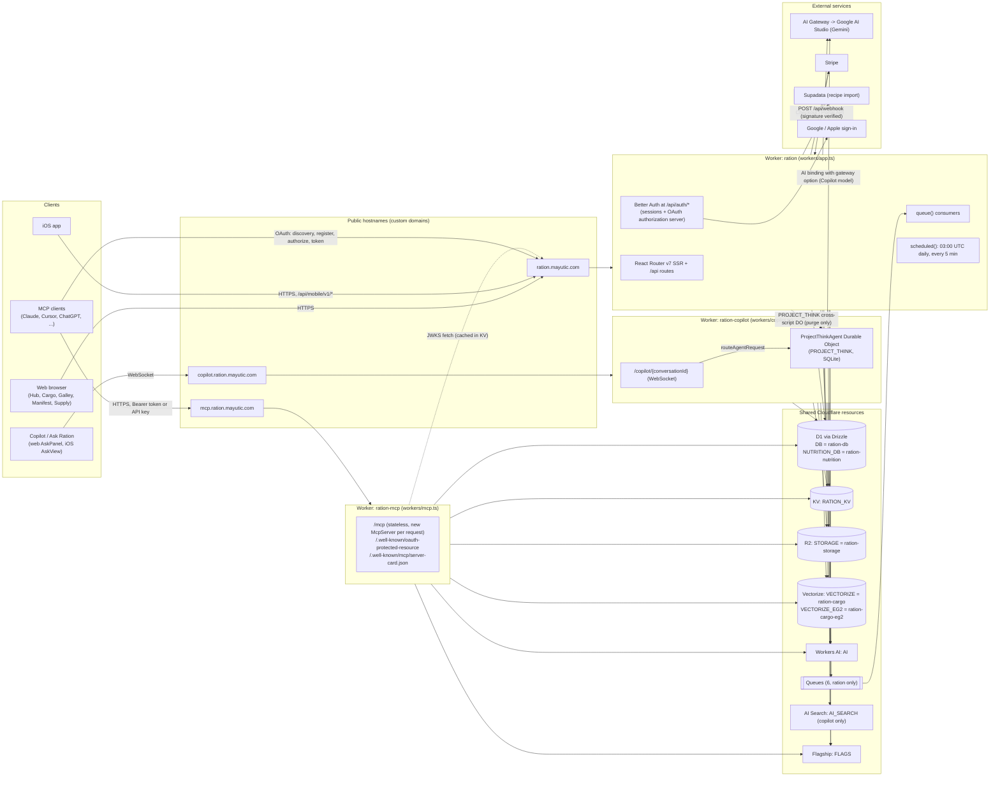

# Request flow across the three Workers

Ration runs as three Cloudflare Workers, each with its own public hostname. There are **no service bindings** between them: none of the three Wrangler configs declares `services`. They share state through the same D1 databases, KV namespace, R2 bucket and Vectorize indexes. They are connected in only three places:

1. `ration-mcp` fetches the OAuth signing keys (JWKS) from the `ration` Worker over public HTTPS at `https://ration.mayutic.com/api/auth/jwks` and caches them in KV.
2. The `ration` Worker has a cross-script Durable Object binding (`PROJECT_THINK`, `script_name: ration-copilot`). It uses this only to purge Copilot conversations when an account or group is deleted.
3. The web app gets a short-lived Copilot handshake token from `ration` (`POST /api/copilot/token`, stored in KV for 60 s) and passes it to `ration-copilot` as `?handshakeToken=`.

## Notes

- **ration**: serves SSR pages, static assets (`ASSETS`), JSON APIs, the mobile API (`/api/mobile/v1/*`) and Better Auth (`/api/auth/*`). It is the only Worker with queue producers and consumers, cron triggers, `send_email` (`EMAIL`, for magic links) and Stripe. HTML responses get security headers in `workers/app.ts`. Older iOS builds get HTTP 426 from `mobileUpgradeRequiredResponse`.
- **ration-mcp**: answers `/mcp` and two discovery documents, and returns 404 for everything else. Before authenticating it checks request size and shape (`enforceMcpRequestLimits`) and applies a per-IP KV rate limit (`mcp_http`). It has no queue bindings, so MCP tools run inline. Auth details are in [auth.md](./auth.md).
- **ration-copilot**: accepts only `/copilot*` from trusted origins. It authenticates the user, checks AI consent and the `ration-copilot` Flagship flag, applies a KV rate limit (`copilot_connect`), then routes the WebSocket to one `ProjectThinkAgent` per organization, user, tier and conversation (`/agents/project-think/{agentName}`).
- **Analytics Engine** (`RATION_ANALYTICS` on ration and ration-mcp, `COPILOT_ANALYTICS` on ration-copilot) and `CF_VERSION_METADATA` are bound on all three Workers. They are left out of the diagram to keep it readable.
- **Smart Placement** (`placement.mode: smart`) is on for all three Workers.
- **RevenueCat**: `ration` receives `POST /api/webhook/revenuecat`. `ration-mcp` and `ration-copilot` use a RevenueCat API secret for `get_billing_summary`. This is left out of the diagram.

## Verified against

- `wrangler.jsonc`: name `ration`, `main: ./workers/app.ts`, route `ration.mayutic.com`, bindings `DB`, `NUTRITION_DB`, `STORAGE`, `RATION_KV`, `AI`, `VECTORIZE`, `VECTORIZE_EG2`, `ASSETS`, `EMAIL`, `FLAGS`, `RATION_ANALYTICS`, `PROJECT_THINK` (`script_name: ration-copilot`), `queues.producers` / `queues.consumers`, `triggers.crons`.
- `wrangler.mcp.jsonc`: name `ration-mcp`, `main: workers/mcp.ts`, route `mcp.ration.mayutic.com`, bindings `DB`, `NUTRITION_DB`, `STORAGE`, `RATION_KV`, `AI`, `VECTORIZE`, `VECTORIZE_EG2`, `FLAGS`, `RATION_ANALYTICS`; no queues and no services.
- `wrangler.copilot.jsonc`: name `ration-copilot`, `main: workers/copilot.ts`, route `copilot.ration.mayutic.com`, bindings `DB`, `NUTRITION_DB`, `STORAGE`, `RATION_KV`, `AI`, `AI_SEARCH`, `VECTORIZE`, `VECTORIZE_EG2`, `PROJECT_THINK` (own class `ProjectThinkAgent`, `new_sqlite_classes`), `FLAGS`, `COPILOT_ANALYTICS`.
- `workers/app.ts`: `fetch` (React Router handler, security headers, 426 upgrade gate), `queue` (dispatch through `AI_QUEUE_HANDLERS`), `scheduled` (two crons).
- `workers/mcp.ts`: route table (`/mcp`, protected-resource metadata, server card), `enforceMcpRequestLimits`, `checkRateLimit(..., "mcp_http", clientIp)`, `authenticateMcp`, `createMcpHandler`.
- `workers/copilot.ts`: `isTrustedOrigin`, `authenticateCopilot`, `isFeatureEnabled(env, "ration-copilot", ...)`, `checkRateLimit(..., "copilot_connect", ...)`, `routeAgentRequest` to `/agents/project-think/{agentName}`, `ProjectThinkAgent`.
- `app/lib/mcp/oauth-token.server.ts`: `fetchJwksJson` (`${authServerUrl}/api/auth/jwks`) and KV cache key `oauth:jwks`.
- `app/lib/copilot/purge.server.ts`: `env.PROJECT_THINK` stub fetch for purge.
- `app/routes/api/copilot.token.ts` and `app/lib/copilot/web-session-token.server.ts`: handshake token in `RATION_KV`, 60 s TTL, single use.
- `app/routes.ts`: `api/auth/*`, `api/webhook`, `api/webhook/revenuecat`, `api/copilot/token`, `api/mobile/v1/*`, `oauth/*`, `.well-known/*`.
- `app/routes/api/webhook.tsx`: `stripe.webhooks.constructEventAsync`.
- `app/lib/ai-gateway.server.ts` (Gemini via AI Gateway fetch) and `app/lib/copilot/model.server.ts` (Copilot via the `AI` binding `gateway` option).
